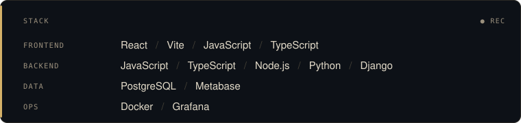

  

  <picture>
    <source media="(prefers-color-scheme: light)" srcset="https://raw.githubusercontent.com/snowyyy66/snowyyy66/main/assets/sparks-light.svg?v=gold1">
    
  </picture>

  <picture>
    <source media="(prefers-color-scheme: light)" srcset="https://raw.githubusercontent.com/snowyyy66/snowyyy66/main/assets/handle-light.svg?v=light1">
    
  </picture> 
  <picture>
    <source media="(prefers-color-scheme: light)" srcset="https://raw.githubusercontent.com/snowyyy66/snowyyy66/main/assets/stack-light.svg?v=light1">
    
  </picture> 
  <a href="mailto:viking123405@gmail.com"><picture>
    <source media="(prefers-color-scheme: light)" srcset="https://raw.githubusercontent.com/snowyyy66/snowyyy66/main/assets/footer-light.svg?v=light1">
    
  </picture></a>

